# Customer Churn Analysis & Prediction


**Saiket Systems Data Science Internship (2026)**: an end-to-end analysis of why customers leave a telecom company, which customers are most at risk, and what the business can do about it.

| | |
|---|---|
| **Intern** | Mohammad Tohfe |
| **Domain** | Data Science |
| **Dataset** | Telco Customer Churn: 7,043 customers, 21 columns |
| **Tasks completed** | All 6 (1 Data Preparation · 2 EDA · 3 Segmentation · 4 Prediction Model · 5 Evaluation · 6 Business Recommendations) |

---

## Key Findings

- **26.5% of customers churned**, taking **$139k of monthly revenue** with them.
- **Contract type is the strongest signal:** month-to-month customers churn at **42.7%**, versus **11.3%** on one-year and **2.8%** on two-year contracts.
- **The first year is the danger zone:** **52.9%** of customers churn within 6 months, versus **6.6%** after 5 years. Churned customers had a median tenure of 10 months compared with 38 for loyal ones.
- **Electronic-check payers churn at 45.3%**, nearly 3x the rate of customers on automatic payments (15–17%).
- **Fiber-optic customers without Online Security or Tech Support churn at 55%.** Adding either service is linked to much lower churn.
- **The riskiest segment** (new, month-to-month, premium spend) churns at **77%**.
- **416 high-value customers are still active but at risk** (top 25% spend, month-to-month). Together they're worth **~$41k/month**.
- **Best model (Random Forest):** catches **78% of churners** with **ROC-AUC 0.84**.
- **Recommended actions** could cut churn from **26.5% to ~21.6%**, for an estimated **~$208k net gain in 12 months**.

---

## Task 1: Data Preparation
[`src/task1_data_preparation.py`](src/task1_data_preparation.py)

- Explored the structure: 7,043 rows, 21 columns, no duplicate customers, target split 73.5% stayed / 26.5% churned.
- **Found hidden missing data:** `TotalCharges` is stored as text and is blank for 11 customers. All 11 have `tenure = 0` (brand-new, not billed yet), so the correct value is **0**, not a value to drop or average.
- Encoded categories: yes/no columns → 0/1 and multi-category columns → one-hot encoding, giving **30 numeric features**.
- Created a **stratified 80/20 train/test split** (5,634 / 1,409) that keeps the 26.5% churn rate in both sets.

## Task 2: Exploratory Data Analysis
[`src/task2_eda.py`](src/task2_eda.py)

| Overall churn | Contract & payment method |
|---|---|
| 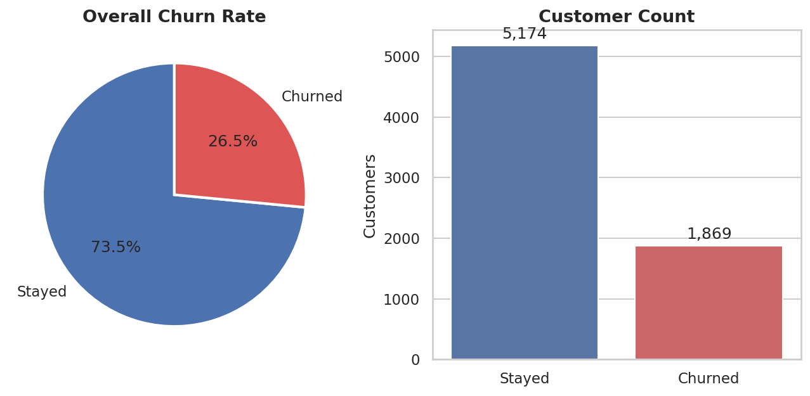 | 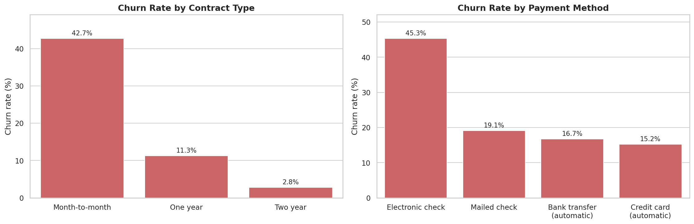 |

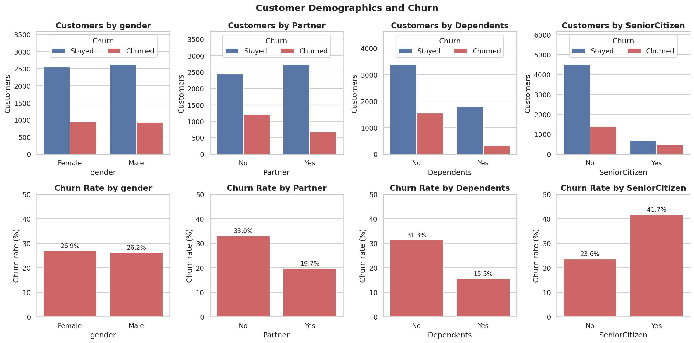

- **Gender makes no difference** (26.9% vs 26.2%).
- Customers **without a partner** (33.0% vs 19.7%) or **without dependents** (31.3% vs 15.5%) churn more often.
- **Senior citizens churn at 41.7%**, compared with 23.6% for other customers.

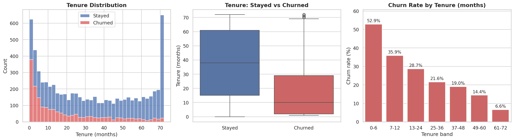

Churn falls steadily with tenure. Most customers who leave do so in their first year.

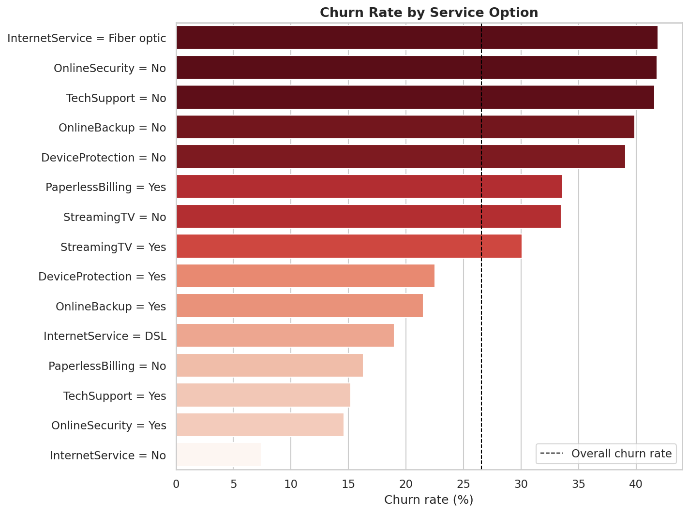

## Task 3: Customer Segmentation
[`src/task3_segmentation.py`](src/task3_segmentation.py)

Customers were segmented by **tenure** (New / Developing / Established / Loyal), **monthly spend** (quartiles: Low / Medium / High / Premium) and **contract type**.

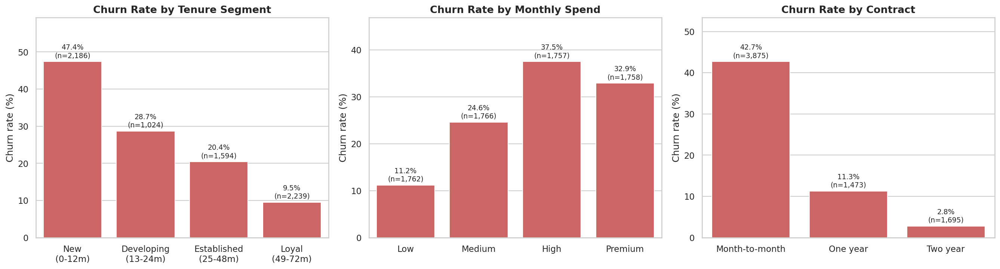
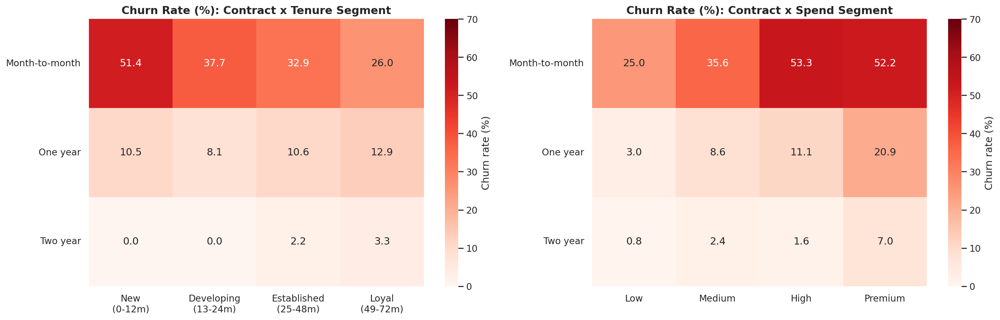

**Riskiest segments** (minimum 30 customers):

| Contract | Tenure | Spend | Customers | Churn rate |
|---|---|---|---|---|
| Month-to-month | New (0-12m) | Premium | 214 | **77.1%** |
| Month-to-month | New (0-12m) | High | 598 | **67.4%** |
| Month-to-month | Developing (13-24m) | Premium | 180 | **56.1%** |
| Month-to-month | New (0-12m) | Medium | 664 | 45.5% |
| Month-to-month | Developing (13-24m) | High | 245 | 44.5% |

**High-value customers at risk:** Premium-tier customers (≥ $89.90/month) on month-to-month contracts churn at **52.2%**. **416 of them are still active**, worth $40,971/month, and they're listed in [`task3_high_value_at_risk_customers.csv`](outputs/reports/task3_high_value_at_risk_customers.csv) for the retention team.

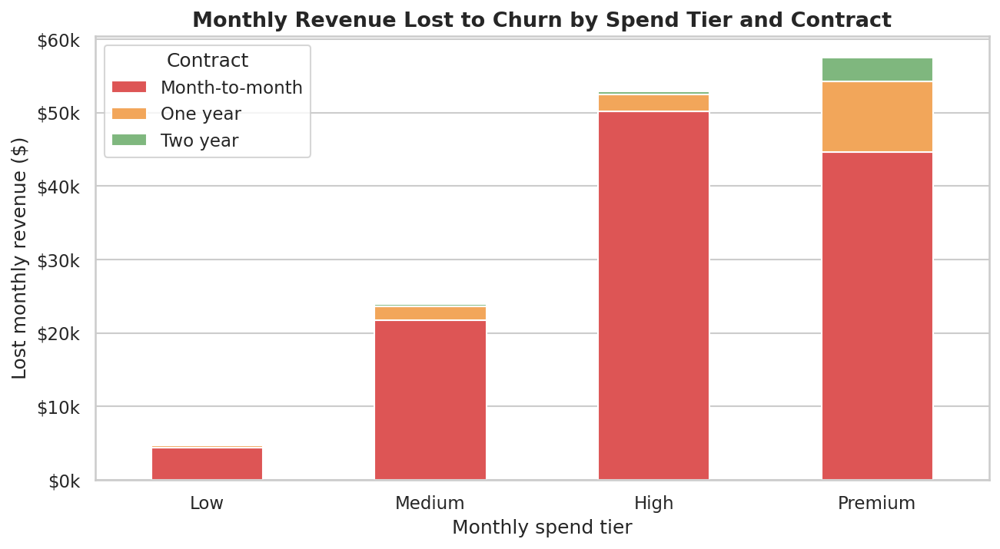

## Task 4: Churn Prediction Model
[`src/task4_churn_prediction.py`](src/task4_churn_prediction.py)

Four algorithms were trained, each in a pipeline of **scaling → feature selection (SelectKBest with mutual information) → classifier**. The number of features and the model hyperparameters were tuned together with **GridSearchCV** (5-fold stratified cross-validation, optimising F1-score). `class_weight="balanced"` compensates for churners being the minority class. The best model was chosen by **cross-validation score**, without looking at the test set.

| Model | CV F1 | Test Accuracy | Precision | Recall | F1 | ROC-AUC |
|---|---|---|---|---|---|---|
| **Random Forest** ⭐ | **0.637** | 0.770 | 0.547 | **0.775** | **0.642** | **0.844** |
| Logistic Regression | 0.629 | 0.743 | 0.510 | 0.781 | 0.617 | 0.838 |
| Decision Tree | 0.617 | 0.754 | 0.526 | 0.770 | 0.625 | 0.838 |
| Gradient Boosting | 0.589 | 0.801 | 0.661 | 0.511 | 0.576 | 0.844 |

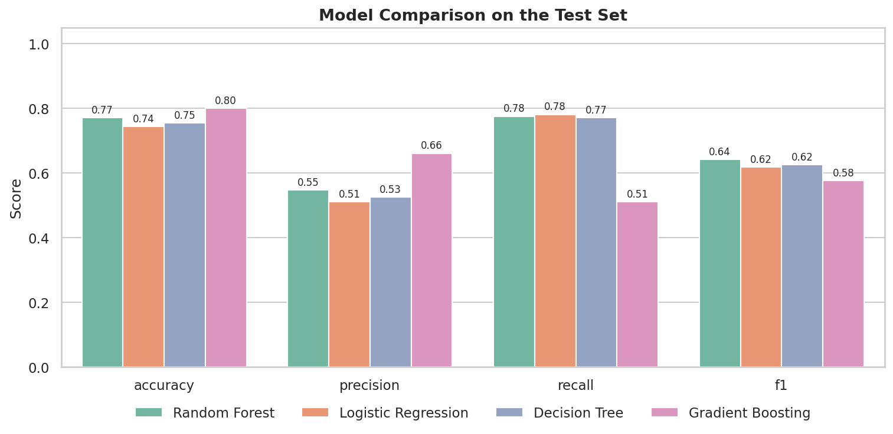

> **Why not pick the highest accuracy?** Simply predicting "nobody churns" already scores 73.5% accuracy and catches no churners at all. For retention, **recall** (finding the customers who will leave) matters most, so models were optimised for F1, which balances recall and precision.

## Task 5: Model Evaluation & Interpretation
[`src/task5_model_evaluation.py`](src/task5_model_evaluation.py)

| ROC curves | Confusion matrix (Random Forest) |
|---|---|
| 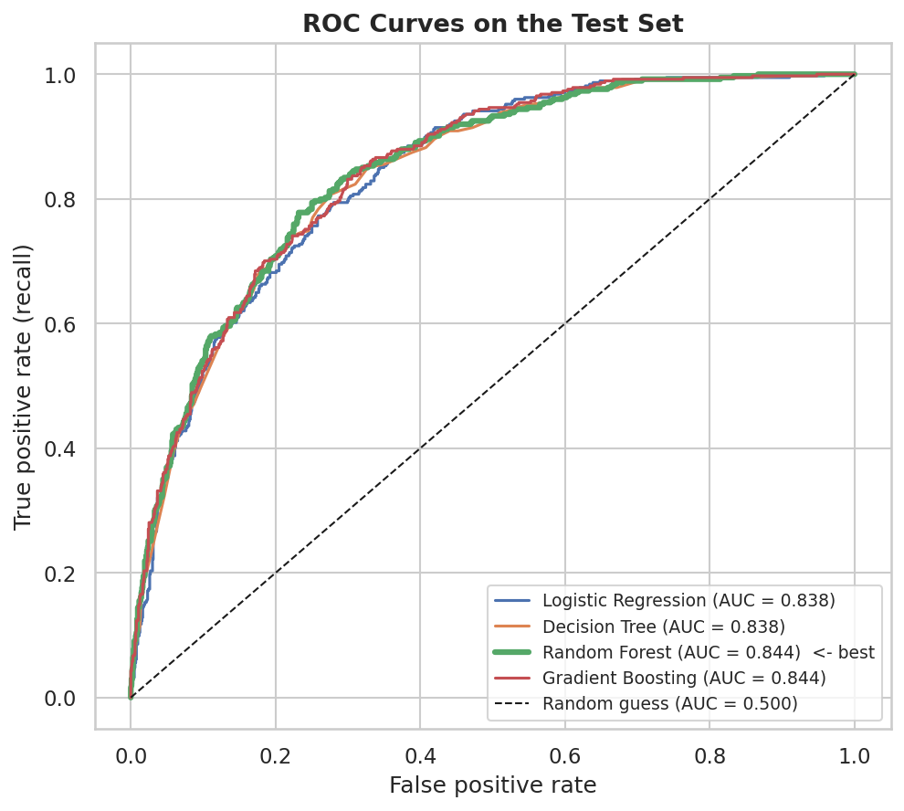 | 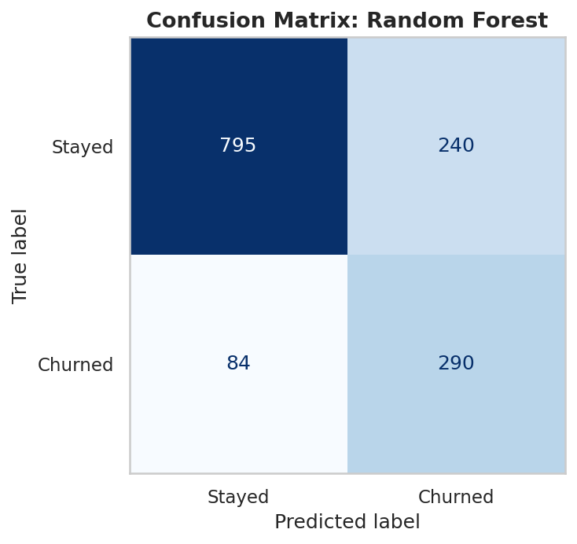 |

On the 1,409 held-out test customers, the Random Forest **correctly flagged 290 of the 374 churners (77.5%)** and missed 84.

| What drives churn (permutation importance) | Which direction (logistic regression) |
|---|---|
| 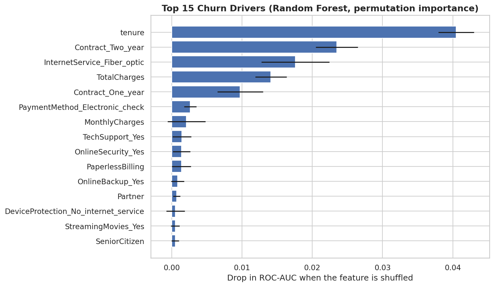 | 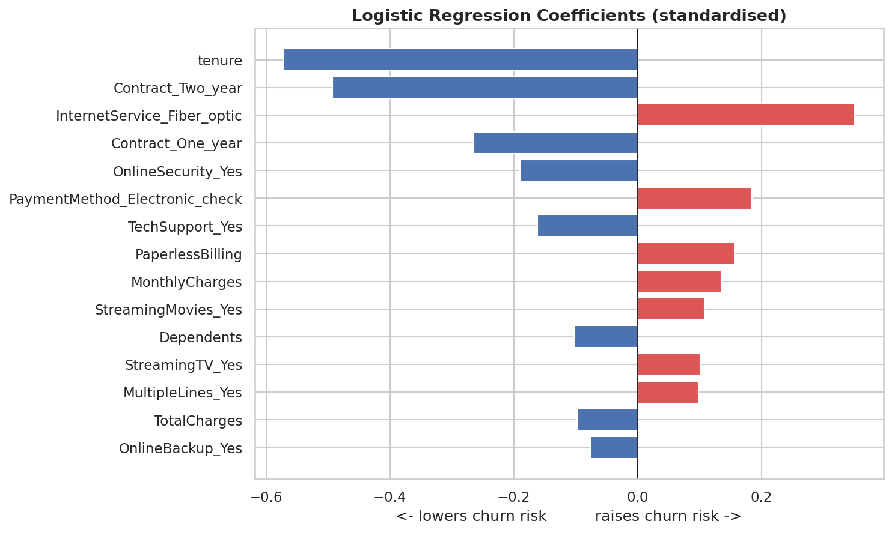 |

- **Raises churn risk:** fiber-optic internet, electronic-check payment, paperless billing, higher monthly charges.
- **Lowers churn risk:** longer tenure, one- or two-year contracts, Online Security, Tech Support.

## Task 6: Business Recommendations
[`src/task6_business_recommendations.py`](src/task6_business_recommendations.py) · full report: [`task6_business_recommendations.md`](outputs/reports/task6_business_recommendations.md)

| # | Recommendation | Target group | Churn now → comparison | Est. 12-month net impact |
|---|---|---|---|---|
| 1 | **Contract upgrade offer**: $5/month off to move to a 1-year contract | 3,875 month-to-month | 42.7% → 11.3% | **+$50.6k** |
| 2 | **Auto-pay migration**: $2/month credit to leave electronic check | 2,365 e-check payers | 45.3% → 16.0% | **+$78.1k** |
| 3 | **Fiber "Security & Support" bundle**: free for 6 months | 1,765 fiber customers without either | 55.0% → 24.5% | **+$56.3k** |
| 4 | **First-year onboarding program**: welcome call and 30/60/90-day check-ins | 2,186 customers in year 1 | 47.4% → 28.7% | **+$111.6k** |
| 5 | **Model-driven early-warning list**: score customers monthly and route high-value at-risk customers to a retention team | 416 high-value at-risk | delivery channel for 1–4 | not double-counted |

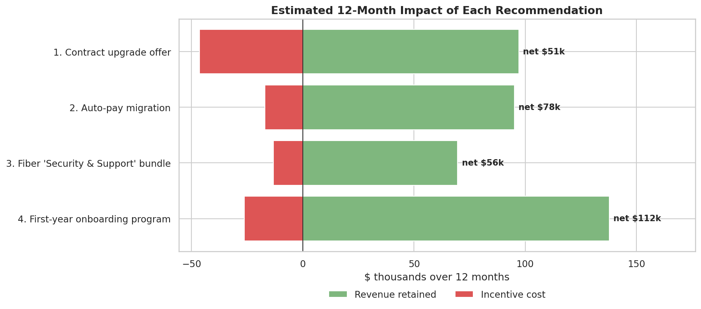

**Combined (overlap-adjusted) estimate:** about **349 customers retained per year**, lowering churn from **26.5% to ~21.6%**, for a **net gain of ~$208k over 12 months**.

The estimates are deliberately conservative. Only **50%** of each observed churn gap is counted, incentive costs are subtracted, and overlap between groups is discounted by 30%. Every assumption is listed in the report. The recommended next step is to **A/B test** each offer on a small group to measure the real uplift.

---

## Getting Started

```bash
git clone https://github.com/moetohfe/Saiket_Data_Science_Internship.git
cd Saiket_Data_Science_Internship
pip install -r requirements.txt

python run_all.py                          # runs Tasks 1-6 (a few minutes)
python src/task2_eda.py                    # or run any single task (Task 1 first)
python -m unittest discover -s tests -v    # 9 unit tests
```

Exact model scores can differ very slightly between scikit-learn versions. The results above come from the committed run.

## Project Structure

```
Saiket_Data_Science_Internship/
├── data/
│   └── Telco_Customer_Churn_Dataset.csv
├── src/
│   ├── common.py                          # paths, cleaning, plot style (shared)
│   ├── task1_data_preparation.py
│   ├── task2_eda.py
│   ├── task3_segmentation.py
│   ├── task4_churn_prediction.py
│   ├── task5_model_evaluation.py
│   └── task6_business_recommendations.py
├── outputs/
│   ├── figures/                           # 16 charts
│   └── reports/                           # CSV tables + recommendations report
├── tests/
│   └── test_pipeline.py
├── run_all.py
├── requirements.txt
└── LICENSE
```

## Tools

Python · pandas · NumPy · scikit-learn · matplotlib · seaborn

## License

MIT. See [LICENSE](LICENSE).
